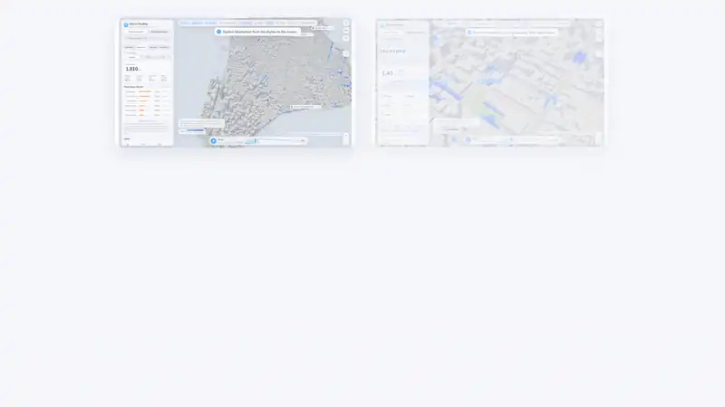
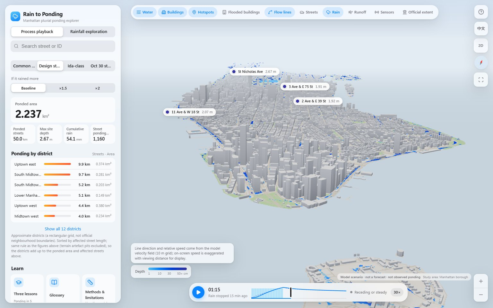
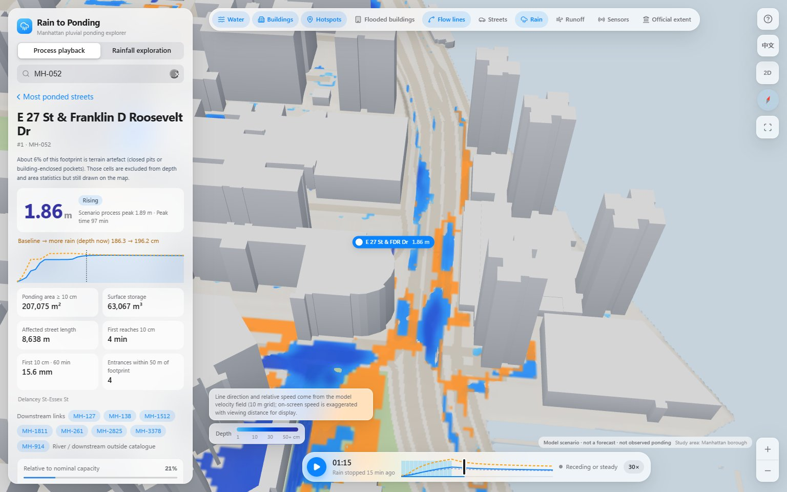
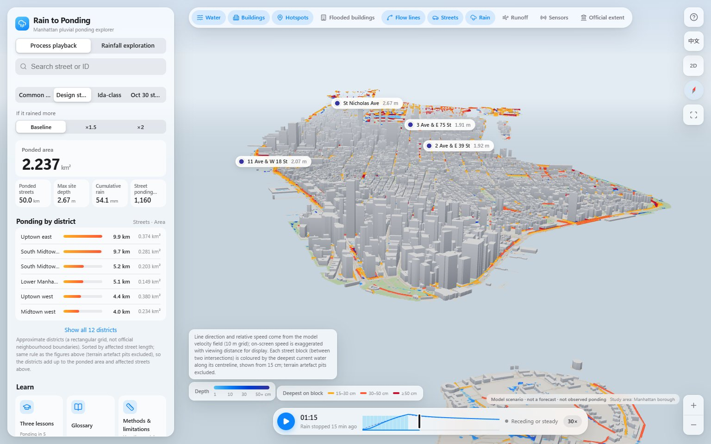
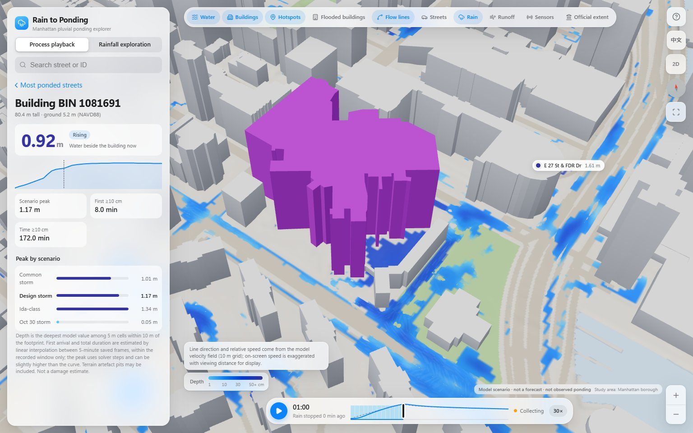
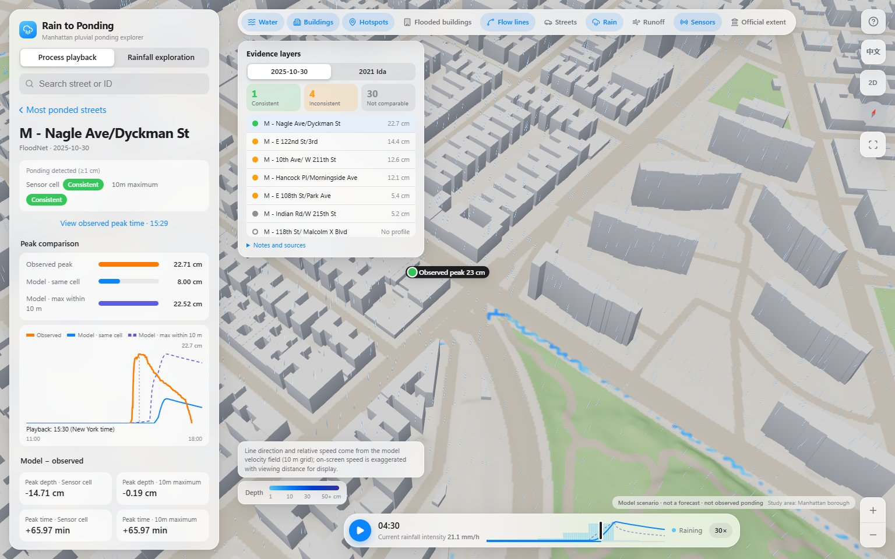
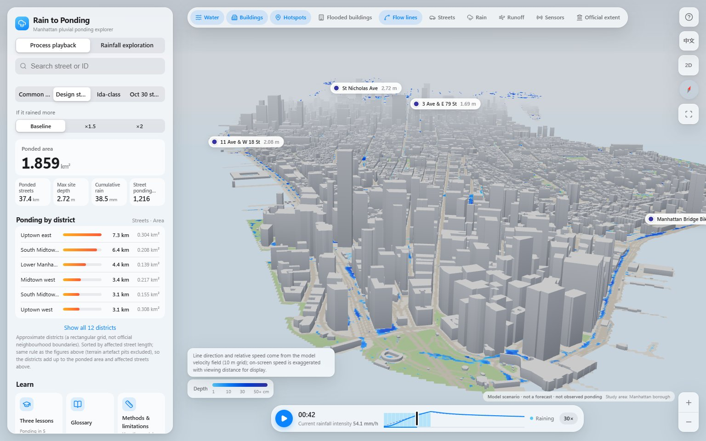

# Rain to Ponding

An interactive 3D model of Manhattan that shows where rainfall collects on the streets, how the ponding grows during a storm, and how that compares with real sensor observations.

**[Methods and limitations](docs/methods.md)** · **[Data sources](DATA_SOURCES.md)** · **[Rights and attribution](RIGHTS.md)**



> **Model scenarios, not forecasts.** The water shown is computed by a simplified surface-flow model. It is not an observed flood map, a prediction or a damage estimate.

**Created by [Bokai He](https://github.com/BokaiHe).** This repository contains the compiled interactive showcase and its display data. The full development source and history are maintained separately.

## What you can do

- **Watch a storm play out** over the whole island: rain falls, water collects in low streets, flow lines follow the model's velocity field, and ponding recedes after the rain stops. Choose a common storm, a design storm, an Ida-class storm or the observed rainfall of 30 October 2025.
- **Ask "what if it rained more":** compare 1.5× or 2× rainfall at the same moment. Cells that newly pass 10 cm turn amber. Each comparison is a separate model run, not a scaled-up depth.
- **Find the worst streets:** street hotspots are ranked by ponded street area, every street block can be coloured by its deepest water, and twelve approximate districts are ranked by affected street length.
- **Click any building** to see the deepest water within 10 m, when it first reached 10 cm, and how long it stayed.
- **Check the model against sensors:** NYC FloodNet depth sensors show observed curves alongside the model at the sensor cell and the maximum within 10 m. The consistent / inconsistent labels compare whether observation and model reach 1 cm over their shared observation times; they do not assess depth or peak-time accuracy. Missing or unsuitable comparisons are labelled not comparable. One click jumps playback to the observed peak.
- **Explore any rainfall:** set 0–200 mm over 30, 60 or 120 minutes and see where depressions fill and spill.
- **Learn by predicting:** three short lessons ask where water collects first, why one place is deeper than another, and whether twice the rain means twice the ponding, then reveal the answer from the model's own data. A glossary and a skippable tour are included.
- Switch between English and Chinese at any time; everything works on desktop and mobile.

## Screenshots

| Whole-island playback                                                              | Twice the rainfall                                                                    |
| ---------------------------------------------------------------------------------- | ------------------------------------------------------------------------------------- |
|  |  |
| **Street blocks and districts**                                                    | **Building card**                                                                     |
|  |  |
| **Sensor comparison**                                                              | **Lower Manhattan while it rains**                                                    |
|  |  |

## About the project

Rain to Ponding explores how rainfall, urban terrain and simplified drainage assumptions shape street ponding in Manhattan. The work combines city-data preparation, model scenarios, a 3D interface and comparisons with independent FloodNet observations. It builds on published hydrological methods and third-party data; these are credited below.

## How it works

Storm playback reads results computed offline in Python; seeking does not rerun the solver. Rainfall exploration evaluates a precomputed depression hierarchy with Fill–Spill–Merge in a browser Web Worker. These are different modes: a storm time series and a final-state exploration.

The dynamic calculation uses a 5 m grid, with 2 m terrain for close views. Building footprints block surface flow. Drainage is a single assumed capacity of 20 mm/h selected against an official modeled scenario, not fitted to sensor depths.

## Try it locally

GitHub Pages has not been enabled yet. This repository is a ready-to-serve static package, not a source-code checkout. After downloading or cloning it, serve the repository folder over HTTP:

```bash
python -m http.server 8000 --bind 127.0.0.1
```

Open http://127.0.0.1:8000/ in a WebGL-capable browser. No Node.js install, Python model pipeline or API key is needed to view this package; Python here is only a local file server. Do not open index.html directly with file://. English is the default; add ?lang=zh for Chinese.

## Limitations

This is an educational model, not an engineering study or a forecast. Sewers and tides are not modeled explicitly; rainfall is spatially uniform. Terrain resolution and blocked passages can create unrealistic pockets. Agreement with the city's modeled extent is modest (F1 about 0.26), and several sensor-depth comparisons show substantial differences. At Nagle Ave, for example, observed peak depth is about 22.7 cm versus 8.0 cm in the model cell. A consistent detection label does not mean accurate water depth or timing.

Flow-line direction and relative speed come from model velocities; on-screen motion is exaggerated. Rain particles are illustrative. The study covers Manhattan only.

## Attribution and reuse

- [Methods and limitations](docs/methods.md)
- [Data sources and published methods](DATA_SOURCES.md)
- [Project rights](RIGHTS.md)
- [Third-party software notices](THIRD_PARTY_NOTICES.md)

No blanket open-source license is granted for the original project materials in this showcase. Third-party software and datasets retain their own terms. No music or soundtrack video is included.
